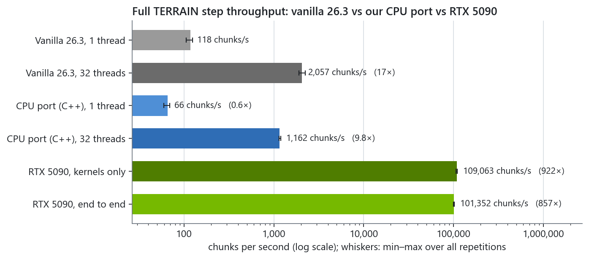
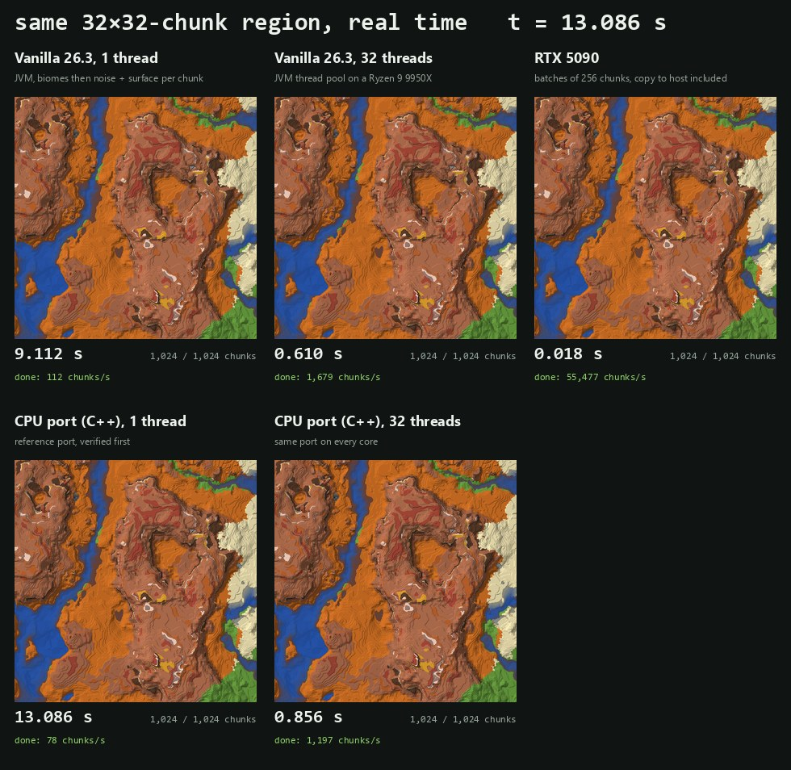
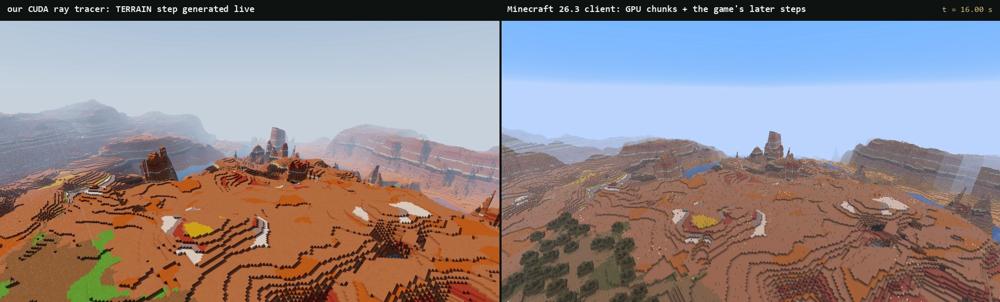
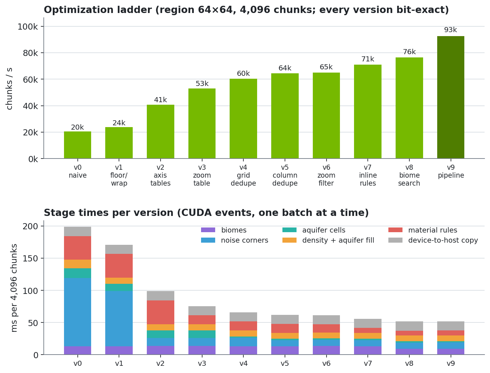

# Minecraft terrain generation on CUDA, bit for bit

Minecraft Java Edition 26.3's overworld terrain generation reimplemented as CUDA kernels.
The output is **bit-identical to vanilla**: every biome, block state and density value is
checked for equality with values computed by the real game, with no tolerance. On an
RTX 5090 it generates the full TERRAIN step (biomes, density with all caves, aquifers,
material rules including ore veins) at **101,352 chunks/s**, which is **857x**
vanilla on one thread and **49x** vanilla on all 32 threads of a Ryzen 9 9950X.



[](docs/videos/race.mp4)

*Click for the video: the same 32×32-chunk region generated by every implementation, replayed at real speed from
each run's per-chunk finish times ([all videos](docs/videos/)).*

[](docs/videos/compare.mp4)

*Click for the video: our CUDA renderer generating terrain live (left) and the real Minecraft 26.3 client flying
the same path through chunks the GPU generated (right; [in-game video](docs/videos/ingame.mp4)). Inside the game,
the same chunks generated by vanilla itself matched the GPU's output: 1,054,507,008 blocks and
17,075,712 biome values, 0 mismatches (structures off; see the report).*

| Full TERRAIN step (no carvers) | chunks/s | ms per chunk | vs vanilla 1 thread |
|---|---:|---:|---:|
| Vanilla 26.3, 1 thread | 118 | 8.46 | 1x |
| Vanilla 26.3, 32 threads | 2,057 | 0.486 | 17.4x |
| CPU port (C++), 1 thread | 66 | 15.16 | 0.6x |
| CPU port (C++), 32 threads | 1,162 | 0.860 | 10x |
| **RTX 5090, end to end** (copy to pinned host memory included) | **101,352** | **0.0099** | **857x** |
| RTX 5090, kernels only | 109,063 | 0.0092 | 922x |

Measured on one machine (Windows 11, clocks unlocked, variance reported); see the
**[full report](docs/report.html)** for method, variance, profiling and the optimization log.
Every number above is produced by `bench/run_all.py` and `docs/make_report.py`.

## Correctness

- A reference oracle drives the real game classes (Minecraft 26.3 server jar through
  Fabric Loom, at runtime on the author's machine) and dumps reference values for 32 seeds
  x 18 chunks: origin, near and far chunks, the world border (+-1,874,999) and the noise
  lattice's 32-bit wrap points, over the full height (y = -64..319).
- `mccuda_tests --set full` compares every level, from RNG streams and single noise
  samples up to final blocks, for the CPU port and both GPU implementations:
  598,000,044 values compared with vanilla, 0 mismatches. A GPU self-test also
  checks the fast biome-zoom path against the plain FP64 one on 2^31 random blocks.
- The benchmark harness also dumps three contiguous regions from vanilla (origin, negative
  coordinates, world border) and compares them with both generators: 113,246,208 blocks,
  0 mismatches.
- Device code uses `-fmad=false -prec-div=true -prec-sqrt=true -ftz=false`, never
  fast-math. Every optimization either performs the same IEEE operations or replaces
  them with integer work that has a written proof of identical results.

## How it got fast



From a direct port (v0, 20,450 chunks/s) to 92,559 chunks/s
(4.5x) on the same 4,096-chunk region. The main lesson:
on a GeForce GPU, FP64 runs at 1/64 of the FP32 rate, and Minecraft's noise does its
coordinate math in FP64. Most of the gain came from removing FP64 work without changing a
single result:

- exact per-axis tables of the noise coordinate setup (y once per seed, x/z per column),
- `Mth.floor` and the noise wrap test as integer work on the IEEE bit pattern,
- a tabulated BiomeManager zoom with a proven-safe FP32 pre-filter (FP64 only for near ties),
- GPU deduplication of positions shared by neighbouring chunks (radix sort, any chunk list),
- a bounded R-tree search that provably returns vanilla's leaf, with the R-tree's
  last-result tie rule resolved by warp-level tie flags,
- an inlined material-rule tree, and a two-slot pipeline that overlaps the copy back to
  the host with the next batch.

## Layout

| path | contents |
|---|---|
| `oracle/` | Java reference harness: drives vanilla, exports the density-function IR and terrain model, dumps reference data, vanilla benchmarks |
| `cpu/` | single-threaded C++ reference port (the debugging ground truth) |
| `cuda/` | code generator (`codegen/gen_router.py`: IR -> CUDA evaluators and material rules) and the GPU pipeline (`src/terrain.cu`) |
| `tests/` | `mccuda_tests`: bit-exactness at every level, environment probes |
| `bench/` | `mccuda_bench`, `run_all.py`, measured results (`results/`) |
| `profiles/` | profiling helpers (Nsight Systems) |
| `docs/` | the report, its generator, and [engineering notes](docs/ENGINE_NOTES.md) on what bit-exactness depends on |

## Build and run

```
powershell -File build.ps1                 # CMake + Ninja + MSVC 14.4x + CUDA 13.1, Release, sm_120
powershell -File oracle\regen.ps1          # reference data from your local game jar (JDK 25)
build\tests\mccuda_tests.exe --set full    # bit-exactness, all levels
python bench\run_all.py                    # all measurements
python docs\make_report.py                 # docs/report.html and docs/img/*.png
```

## Data and legal hygiene

The algorithms are reimplemented in our own code. No decompiled Mojang source and no game
files are in this repository. Game-derived data (the density-function graph, the terrain
model and the oracle dumps) is extracted at runtime from the user's own copy of the game
into the git-ignored `data/` directory; the CUDA evaluators generated from it live only in
the build tree.

## Scope

Overworld, Minecraft 26.3. Not included: carvers, structures, blending with old chunks,
features and lighting. The optional Fabric/JNI server mod was not started.
